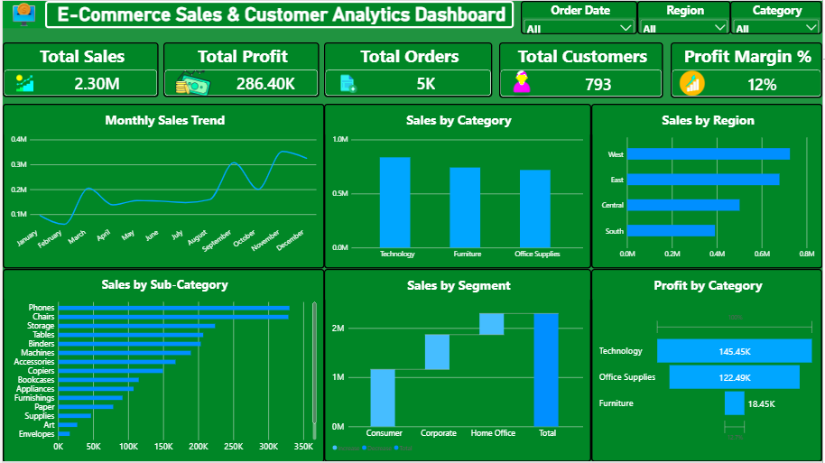
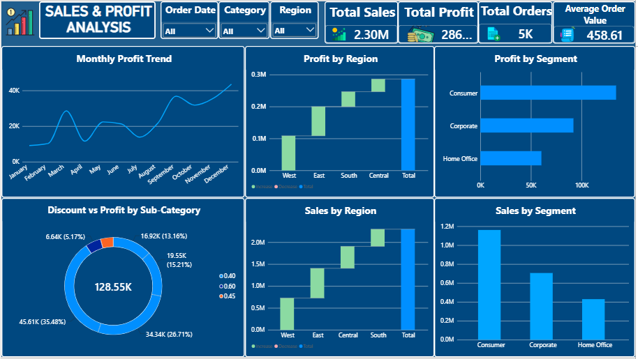
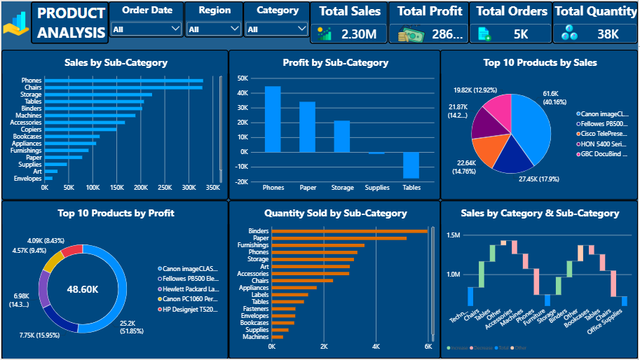
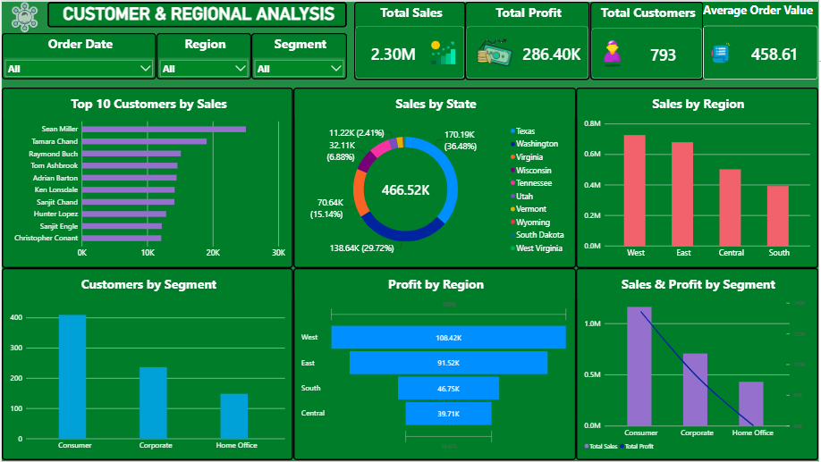

# E-Commerce Sales & Customer Analytics Dashboard

## Project Overview

This project analyzes e-commerce sales, profitability, product performance, and customer behavior using Microsoft Power BI. The interactive dashboard transforms raw sales data into meaningful business insights to support data-driven decision-making.

## Business Objectives

- Monitor overall sales and profit performance.
- Analyze sales and profitability trends.
- Identify top-performing products and categories.
- Understand customer purchasing behavior.
- Compare sales performance across regions.
- Support business decisions through interactive visualizations.

## Tools & Technologies

- **Power BI** — Interactive dashboard development
- **Power Query** — Data cleaning and transformation
- **DAX** — Measures and KPI calculations
- **Data Visualization** — Charts, cards, and analytical reports

## Key Performance Indicators (KPIs)

- Total Sales
- Total Profit
- Total Customers
- Average Order Value

## Dashboard Pages

### 1. Executive Overview

Provides a high-level summary of business performance through key metrics and visualizations.

### 2. Sales & Profit Analysis

Examines sales and profit performance to identify trends and business patterns.

### 3. Product Analysis

Analyzes product performance to understand which products and categories contribute to business results.

### 4. Customer & Regional Analysis

Explores customer-related metrics and regional sales performance.

## Skills Demonstrated

- Data cleaning and transformation
- Data modeling and DAX calculations
- KPI development
- Interactive dashboard design
- Sales and customer analytics
- Business insight communication

## Project Files

- `ECommerce_Sales_Dashboard.pbix` — Power BI project file
- Dashboard screenshots — Visual previews of the four report pages

## How to View the Project

1. Download `ECommerce_Sales_Dashboard.pbix` from this repository.
2. Open the file using Microsoft Power BI Desktop.
3. Explore the report pages and interact with the available filters and visuals.

## Conclusion

This project demonstrates practical data analytics skills using Power BI, Power Query, and DAX to explore e-commerce sales, profitability, products, customers, and regional performance.

---

**Created as part of my Data Analytics portfolio.**
